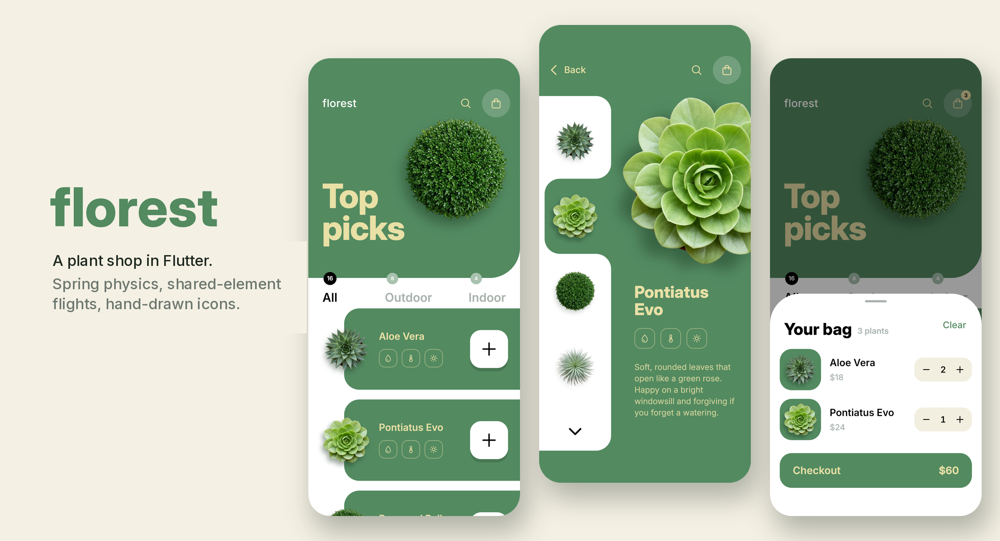
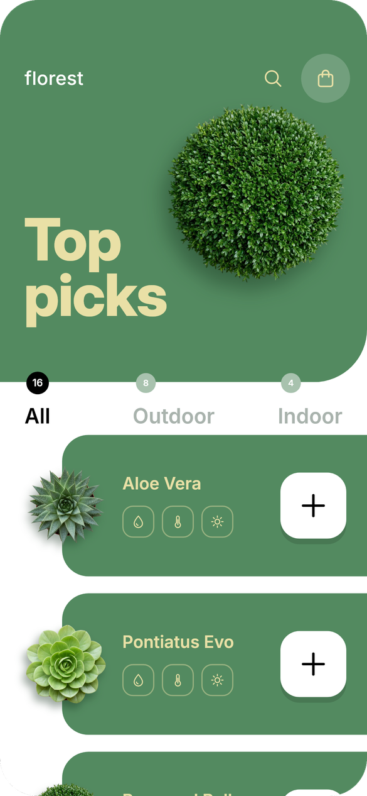
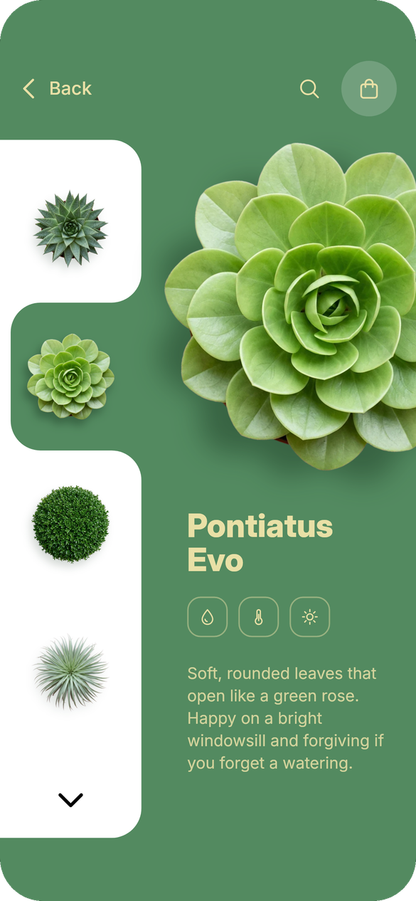
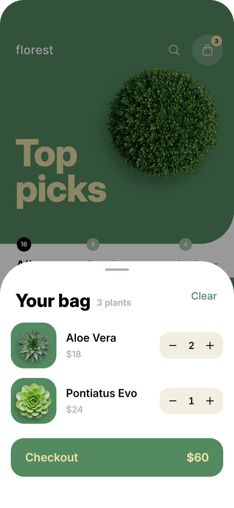
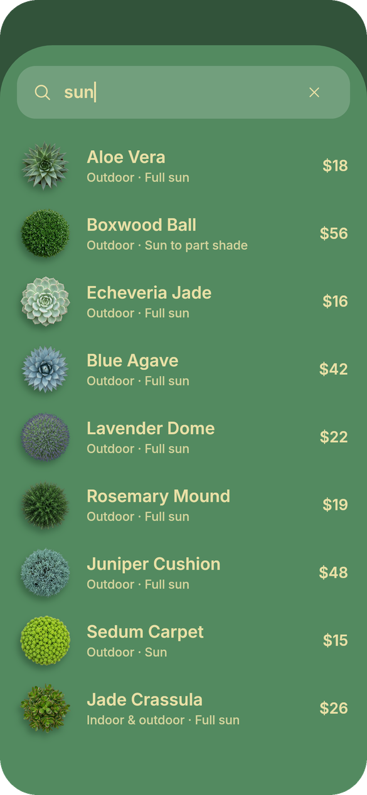

<p align="center">
  
</p>

<p align="center">
  <a href="https://github.com/bileldh-ing/florest/actions/workflows/ci.yml"></a>
  
  
  
  
</p>

**florest** is a two-screen plant shop built in Flutter from a Dribbble-style
reference shot, then taken further: every surface moves on real spring physics,
plants fly between screens as shared elements, and the whole UI is drawn with
custom painters and hand-tuned icons rather than stock widgets.

| Home | Detail | Bag | Search |
|:---:|:---:|:---:|:---:|
|  |  |  |  |

> Screenshots are rendered by the test suite itself (`test/screenshots_test.dart`),
> so they always match the code.

## Highlights

- **Shared-element flight with rotation continuity.** Tapping a card opens a
  circular reveal from your finger while the plant flies to the detail screen.
  The Hero shuttle blends the angle from 0 to the live idle spin, so the plant
  lands exactly where the detail plant already is, with no jump.
- **Animated concave notch.** The detail rail's selection cut-out is a
  `CustomPainter` path (convex rail corners, rounded inner corners) whose
  position follows a `SpringSimulation` (mass 1, stiffness 180, damping 18).
- **Physical big plant.** Drag in a circle to spin it, with friction inertia
  after release; pinch to zoom 1–1.6× with a spring back; flick vertically to
  change plant.
- **Add-to-bag choreography.** `+` spins into a check, the plant arcs along a
  Bézier curve into the bag, the badge bumps elastically, a light haptic fires
  and an Undo snackbar appears.
- **Collapsing hero header** with parallax, a mini title that fades in, a
  pull-down stretch, and count badges that straddle the header edge.
- **Real bag and search.** Bag sheet with quantity steppers, swipe-to-remove
  and an animated total; accent-insensitive search across name, type and light.
- **One ticker for every idle spin.** A single 60 s `AnimationController`
  drives all rotating plants, and it stops when the OS asks for reduced motion.
- **Drawn, not borrowed.** Thin round-capped icons (`LineIcon`) painted on a
  24-unit grid to match the mock; plant shadows are each plant's own blurred
  silhouette, cached behind a `RepaintBoundary`.

## Gestures

| Where | Gesture | Result |
|---|---|---|
| Card | Tap | Circular reveal + Hero flight to detail |
| Card | Long press | Care quick-peek sheet + haptic tick |
| `+` | Tap | Spins to ✓, plant arcs into the bag, badge bumps, Undo |
| List | Swipe left / right | All / Outdoor / Indoor (follows the finger) |
| List | Scroll / pull down | Header collapses with parallax / stretches and snaps back |
| Rail or big plant | Swipe up / down | Next / previous plant, notch glides on a spring |
| Big plant | Drag in a circle | Rotates with inertia, idle spin carries on |
| Big plant | Pinch | Zoom 1–1.6×, springs back |
| Bag row | Swipe left | Remove the plant |
| Detail | Swipe from left edge / Back | Reverse Hero to home |

## Getting started

```bash
git clone https://github.com/bileldh-ing/florest.git
cd florest
flutter pub get
flutter run              # debug
flutter run --profile    # judge smoothness on a real device
```

Requires Flutter 3.27+ (Dart 3.6+). Fonts and images are bundled, so the app
runs fully offline.

## Quality

```bash
flutter analyze                                   # strict lints, zero issues
dart format --set-exit-if-changed lib test
flutter test                                      # unit + widget tests
flutter test --tags screenshots --update-goldens  # re-render the README shots
```

- **Strict analysis:** `strict-casts`, `strict-inference`, `strict-raw-types`
  and ~25 extra lint rules on top of `flutter_lints`.
- **Tests:** catalog and counts, price formatting, bag maths, search, plus
  widget tests for navigation, tabs, add/undo, bag stepper and swipe, search,
  care sheet, reduced motion, small-phone layout, and Flutter's tap-target and
  labelling accessibility guidelines.
- **CI:** GitHub Actions runs format, analyze and tests on every push.

## Architecture

```
lib/
  main.dart                    app shell + shared idle-rotation ticker
  core/
    theme.dart                 colours, radii, durations, spring, text styles
    assets.dart                sized image provider + precache helper
  data/
    plant.dart                 immutable Plant model, price formatting
    plants_repo.dart           16 plants (8 outdoor, 4 indoor, 4 both)
  state/
    providers.dart             filter, selection, bag + derived lines/total (Riverpod)
  features/
    home/                      home screen, hero header, tabs, cards, add button, care sheet
    detail/                    detail screen, side rail, notch painter, plant info
    bag/                       bag sheet
    search/                    search sheet + pure search function
  widgets/                     plant image, rotating plant, line icons, bag button,
                               fly-to-bag overlay, reveal route, screen frame
test/
  unit/  widget/  screenshots_test.dart  helpers.dart
tool/
  key_magenta.py               cut a magenta-backdrop shot into a trimmed WebP
  fetch_images.py              optional: swap in real photos (Pixabay / Commons)
  gen_placeholders.py          optional: flat procedural stand-ins
```

**State.** Riverpod `Notifier`s hold the three pieces of mutable state (filter,
selected plant, bag of ids). Everything else is derived: tab counts,
filtered lists, grouped bag lines and the total are plain `Provider`s, so they
can never drift out of sync. Prices are integer cents.

**Performance.** Every plant image is decoded at its displayed size ×
devicePixelRatio through one `ResizeImage` provider, so precache keys always
match what's painted. Rotating plants and the notch painter sit behind
`RepaintBoundary`s; scroll offset drives only the header through a
`ValueNotifier`; lists use fixed `itemExtent`.

**Accessibility.** Every control has a semantic label and a 48 × 48 target,
cards expose a single descriptive node, tabs announce their counts and
selection, and reduced motion disables idle spin, staggers and the fly
animation.

## Design notes

- Layout is measured from the reference shot at a 390 pt baseline and scaled
  by screen width.
- Inter is bundled as static weights (400–800) subset to Latin.
- The 16 plant images are original AI-generated top-down studio shots, cut out
  with `tool/key_magenta.py`. See [CREDITS.md](CREDITS.md).
- Outdoor and Indoor tabs show only that exact type, so the badges read
  16 / 8 / 4 like the reference; "both" plants appear under All.

## Credits

Plant images, font licence and tools are listed in [CREDITS.md](CREDITS.md).
Built by [Bilel Dhahri](https://github.com/bileldh-ing).
